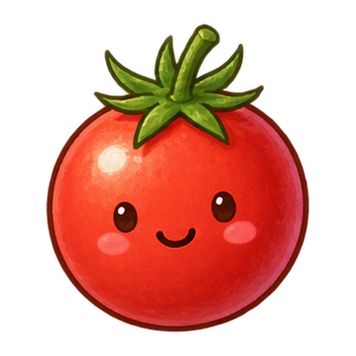
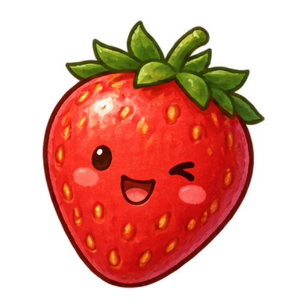
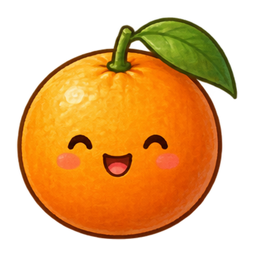

<div align="center">

# 🍇 Sadari Game

**과일을 고르고, 한 명씩 타고 내려가세요.**

과일 캐릭터와 함께하는 웹 사다리타기 게임입니다.<br />
참가자와 당첨내용을 정하고, 사다리를 따라 결과를 확인하세요.






[](LICENSE)

[주요 기능](#주요-기능) · [빠른 시작](#빠른-시작) · [사용 방법](#사용-방법) · [프로젝트 구조](#프로젝트-구조) · [테스트](#테스트)

</div>

---

## 주요 기능

- **2~16명 참가** — 참가자 수와 이름을 설정합니다.
- **16종의 과일 말** — 중복 없이 배정되며, 설정 화면에서 눌러 다른 과일로 바꿀 수 있습니다. 16명이 모두 참가하면 모든 과일을 사용하므로 변경되지 않습니다.
- **당첨내용 설정** — 당첨 수를 1개부터 참가자 수까지 정하고, 각 내용을 직접 입력합니다.
- **경로 애니메이션** — 과일이나 결과를 누르면 해당 참가자의 이동 경로를 따라갑니다.
- **전체 확인과 결과 발표** — 모든 참가자의 결과를 공개하고 당첨 경로를 표시합니다.
- **반응형 화면** — 넓은 사다리는 가로로 스크롤할 수 있습니다. 기기의 동작 줄이기 설정을 사용하면 이동 애니메이션 없이 결과를 공개합니다.

별도의 서버 API, 데이터베이스, 로그인 없이 브라우저에서 동작합니다. 게임 상태는 메모리에만 유지되며 새로고침하면 초기화됩니다.

## 빠른 시작

**검증 환경:** Node.js 24, npm 11

프로젝트 폴더에서 실행합니다.

```bash
npm ci
npm run dev
```

터미널에 표시되는 로컬 주소를 브라우저에서 엽니다. 기본 주소는 `http://localhost:5173`이며, 포트 사용 여부에 따라 달라질 수 있습니다.

별도의 환경 변수 설정은 필요하지 않습니다.

## 사용 방법

1. **참가자 수**를 정합니다. 기본값은 4명입니다.
2. **이름과 과일 말**을 설정합니다. 이름을 비우면 `참가자 1`처럼 자동으로 채워집니다.
3. **당첨 수**를 정합니다. `내용 직접 입력`을 선택하면 당첨내용을 입력할 수 있으며, 빈 내용은 `내용 1`처럼 채워집니다.
4. **사다리 만들기**를 누릅니다.
5. 과일이나 하단 결과를 눌러 한 명씩 확인하거나, **전체 확인**으로 모든 결과를 공개합니다. 전체 확인은 당첨 경로만 그립니다.
6. 모두 공개되면 **결과 발표** 목록을 확인합니다. **처음부터** 또는 **다시 하기**를 누르면 설정 화면으로 돌아갑니다.

> 결과는 사다리를 만들 때 결정됩니다. 참가자를 누르는 순서는 결과에 영향을 주지 않습니다.

## 개발 명령어

| 명령어 | 설명 |
| --- | --- |
| `npm run dev` | 개발 서버 실행 |
| `npm test` | 사다리 로직과 과일 선택 테스트 실행 |
| `npm run build` | TypeScript 타입 검사 후 프로덕션 빌드 |
| `npm run preview` | 빌드한 `dist/`를 로컬에서 미리보기 |

### 빌드와 배포

```bash
npm run build
npm run preview
```

빌드 결과는 `dist/`에 생성됩니다. 해당 폴더를 정적 파일 호스팅 서비스에 배포할 수 있습니다. `preview`는 빌드 확인용 로컬 서버입니다.

하위 경로에 배포할 때는 배포 주소에 맞게 Vite의 `base`를 지정합니다. 예를 들어 `/sadari-game/` 경로에 배포한다면 다음과 같이 빌드합니다.

```bash
npm run build -- --base=/sadari-game/
```

과일 이미지 경로도 `import.meta.env.BASE_URL`을 사용해 해당 경로를 따릅니다.

## 기술 구성

| 영역 | 구성 |
| --- | --- |
| UI | React 19, TypeScript 7 |
| 개발·빌드 | Vite 8, React 플러그인 |
| 스타일 | SCSS, 디자인 토큰 |
| 사다리 렌더링 | SVG |
| 캐릭터 이미지 | WebP 정적 에셋 |
| 테스트 | Node.js 내장 테스트 러너, `node:assert/strict` |

## 프로젝트 구조

```text
sadari-game/
├── public/fruits/          # 과일 캐릭터 16종
├── src/
│   ├── App.tsx            # 설정·플레이 화면 전환과 게임 상태
│   ├── components/
│   │   ├── SetupForm.tsx  # 참가자·과일·당첨내용 설정
│   │   └── PlayBoard.tsx  # SVG 사다리와 결과 화면
│   ├── board/
│   │   ├── usePlay.ts     # 공개 상태와 애니메이션 제어
│   │   ├── geometry.ts   # 사다리 배치와 경로 좌표
│   │   └── colors.ts     # 참가자별 경로 색상
│   ├── ladder.ts          # React와 독립적인 게임 로직
│   ├── fruits.ts          # 과일 선택과 이미지 경로
│   ├── types.ts           # 게임·설정 타입
│   ├── styles/            # 토큰·기본·설정·플레이 스타일
│   └── main.tsx           # 앱 진입점
├── tests/                 # 사다리·과일 로직 테스트
├── index.html
└── vite.config.ts
```

### 게임 동작

`SetupForm`에서 받은 설정으로 `App`이 `createGame()`을 호출합니다. 이 함수는 기본 8단 사다리의 가로선, 출발점과 도착점의 매핑, 섞인 결과 항목을 생성합니다.

`PlayBoard`는 생성된 데이터를 SVG로 표시하고, `usePlay`가 참가자별 공개 상태와 이동 애니메이션을 관리합니다. 참가자 인덱스가 `s`일 때 최종 결과는 다음과 같습니다.

```ts
game.outcomes[game.mapping[s]]
```

핵심 로직은 [src/ladder.ts](src/ladder.ts)에 모여 있습니다. `createGame({ n, results, seed })`에 같은 설정과 시드를 전달하면 동일한 게임을 재현할 수 있습니다. 시드 지정은 코드에서 지원하며 설정 화면에는 노출하지 않습니다.

## 테스트

```bash
npm test
```

현재 12개 테스트는 다음 항목을 검증합니다.

- 가로선 겹침 방지와 출발점·도착점의 일대일 매핑
- 당첨 개수 및 결과 항목 보존
- 시드 기반 재현성과 경로·도착점 일치
- 참가자 수·결과 수·행 수의 입력 경계값
- 가로선 생성 옵션과 정렬, 열별 연결 수
- 과일 에셋 경로, 중복 없는 선택과 미사용 과일 탐색

테스트 범위는 순수 로직입니다. 화면 조작, 애니메이션 타이밍, 실제 이미지 표시는 브라우저에서 별도로 확인해야 합니다.

## 라이선스

[MIT](LICENSE) © 2026 bearholmes
